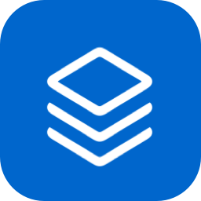
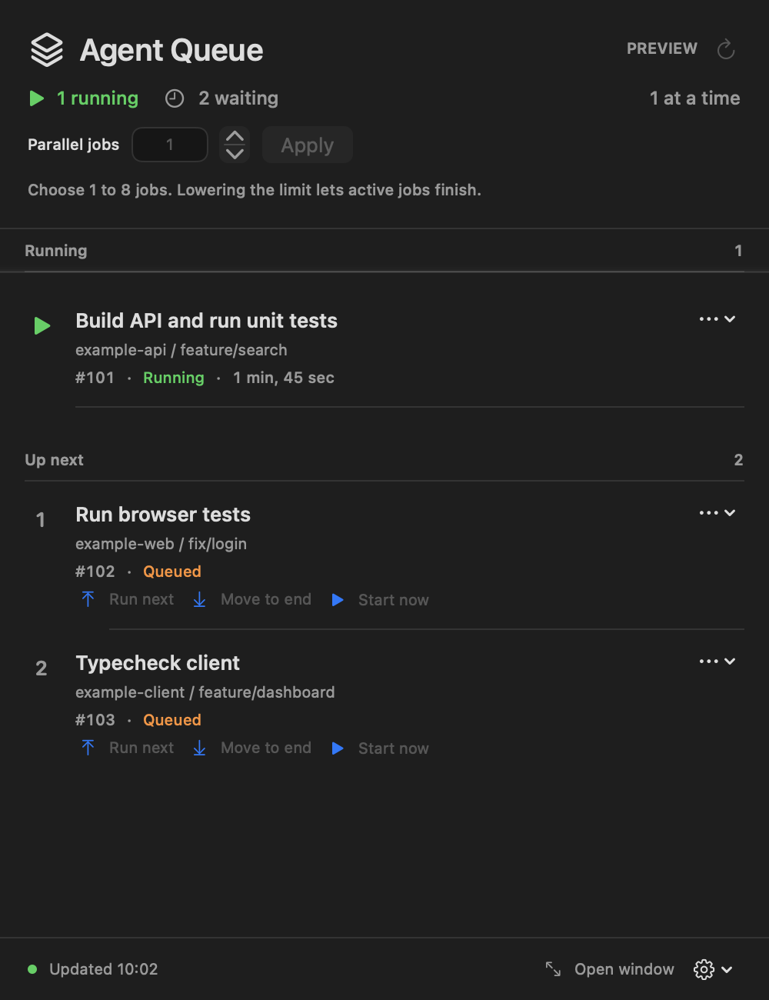
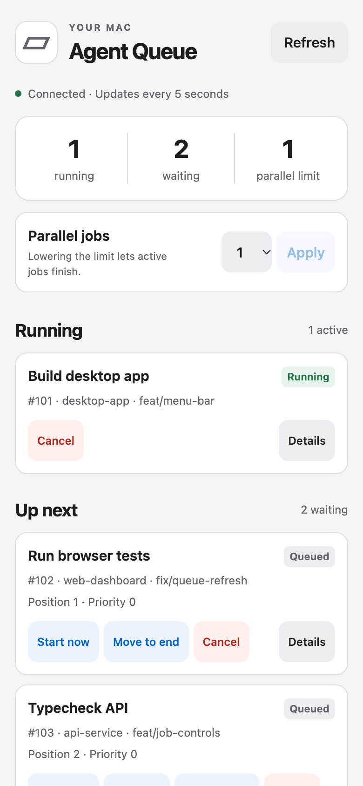
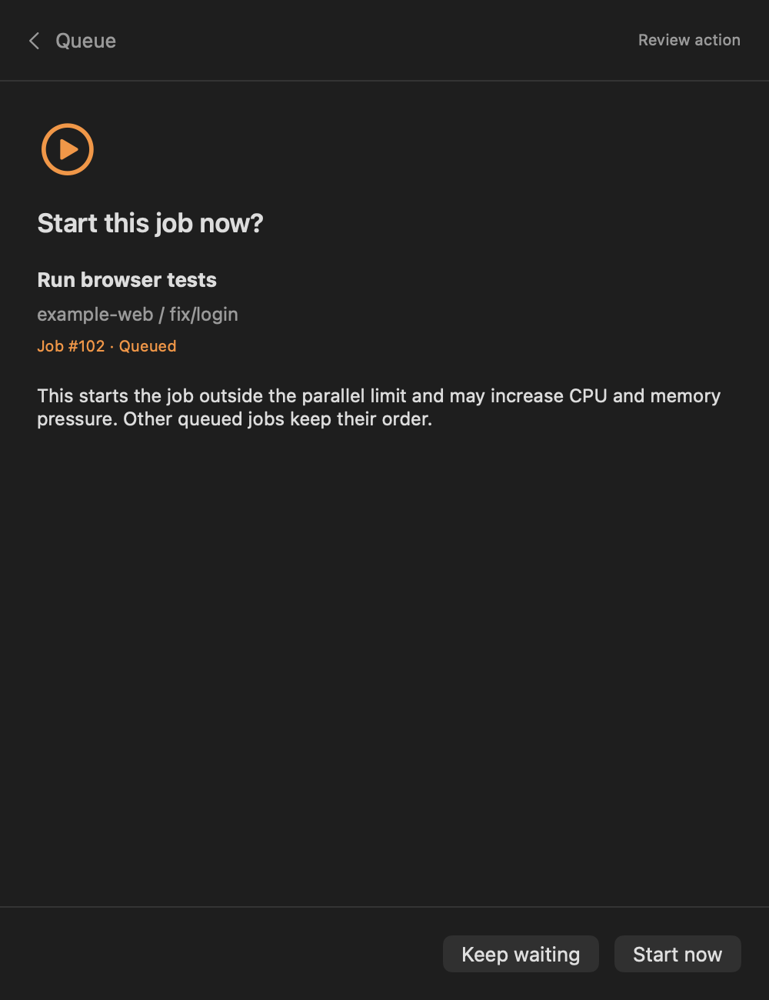
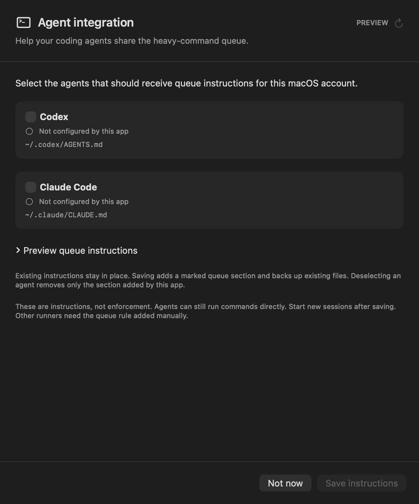

# Agent Job Queue



[](https://github.com/Dunky13/agent-job-queue/actions/workflows/ci.yml)
[](https://github.com/Dunky13/agent-job-queue/actions/workflows/distribution.yml)
[](LICENSE)

Run many coding agents while sharing a limited number of heavy local job slots. Agents can read, reason, and edit concurrently. Builds, test suites, type checks, and other expensive commands wait their turn.

The macOS menu-bar app shows what is running, what is waiting, and which project and branch each job belongs to. An optional private web dashboard works from a phone over home Wi-Fi or a VPN.

| Mac menu-bar queue | Phone dashboard |
| --- | --- |
| [](docs/screenshots/mac-queue.png) | [](docs/screenshots/phone-queue.png) |

Screenshots use sample jobs. The Mac image uses the app's safe preview mode.

<details>
<summary>Start a waiting job in parallel</summary>



</details>

## Download and install

### Homebrew

On macOS 15 or later, obtain the installer and CLI links through the project's [Homebrew tap](https://github.com/Dunky13/homebrew-agent-job-queue):

```sh
brew install --cask dunky13/agent-job-queue/agent-job-queue
```

Open **Agent Job Queue Installer.app** in your account's Applications folder and choose **Install**. It completes queue setup and installs the menu app. Homebrew links `agent-heavy` and `agent-remote` into its bin directory; those links become ready after setup. Finish all queued and running jobs before installing or upgrading the runtime. If macOS requires background-service approval, review Agent Queue in System Settings, then finish installation. Opening the menu app checks readiness without installing or repairing files. No Xcode is needed.

New releases produced by the notarized release pipeline use Developer ID signatures and Apple notarization. Their Homebrew cask verifies the download's SHA-256 and retains quarantine for macOS assessment. It does not bypass Gatekeeper. Older published builds remain ad hoc signed; their historical casks are preserved until a newer release replaces them. See [Apple signing and notarization](docs/apple-signing.md) for the release requirements and verification limits.

The tap becomes installable after the first validated `main` installer release is published. It tracks published builds, so updates can use:

```sh
brew upgrade --cask dunky13/agent-job-queue/agent-job-queue
```

After a Homebrew upgrade, open the updated installer and choose **Install** to upgrade Agent Queue. Homebrew's install-hook sandbox cannot access the private queue socket or manage native services, so Homebrew owns installer delivery while the explicit installer owns the runtime app. Each successfully published main installer triggers and verifies its Homebrew delivery. Scheduled reconciliation provides recovery. Maintainer setup, failure handling and trusted tap tooling synchronization are documented in [Verified Homebrew delivery](docs/homebrew-delivery.md).

Homebrew uninstall removes its installer and command links. It leaves the installed Agent Queue app, its private command entry points and services in place. To remove a managed runtime, finish queued and running jobs, then run the following command before moving the app to Trash:

```sh
agent-heavy install --app-bundle "$HOME/Applications/Agent Queue.app" --unregister-services
```

Use the app's actual absolute Applications path if it differs. Exit zero confirms service shutdown and retires generated command entry points. Queue history, configuration, credentials and certificate data are preserved. Quitting the menu app during ordinary use leaves the independent queue and enabled phone access running.

### Disk image and explicit setup

1. Use macOS 15 or later on an Apple Silicon or Intel Mac.
2. Download the DMG from [Releases](https://github.com/Dunky13/agent-job-queue/releases), then open it. Successful main CI builds trigger distribution; a prerelease appears after notarization and both architecture checks pass. CI runs also retain the installer as an artifact for 30 days.
3. Drag **Agent Queue.app** to **Applications**, then open the copied app. Choose **Install and set up** and confirm to verify the package and queue and register its background services. Opening the app alone only checks readiness. Finish all queued and running jobs before replacing an existing app.
4. Complete any background-service approval requested in System Settings, then finish installation. The app appears in your menu bar once setup succeeds. Add your local bin directory to your shell's `PATH` to use `agent-heavy` by name.

The ZIP and Homebrew retain **Agent Job Queue Installer.app**; open it and choose **Install**. Copying a managed app alone does not complete queue setup. The copied app offers the same explicit setup workflow without installing anything automatically.

If setup reports a pending installation, **Finish the retained pending installation** completes that exact app before upgrading. **Repair and continue** can perform this verified recovery too. If the exact pending app is unavailable, the diagnostic identifies its build and commit; retrieve that build from the release history and finish setup before replacing it. Preserve pending installation records and retained application backups. The ZIP installer is useful for recovery because it can finish the retained app before copying its replacement.

The app includes prebuilt universal executables and a Go queue daemon. The Go remote service embeds Caddy's HTTPS and authentication modules. Homebrew, Pueue, Python, uv, Xcode, and a Go toolchain are not required on the installed Mac. Backend setup runs in your user account without `sudo` and defaults to your account's Applications folder. Executable locations must be protected from replacement by other accounts; a group-writable shared Applications folder is refused without changing its permissions. The payload is self-contained, but first-launch Gatekeeper assessment can require Apple connectivity. Offline first launch of the standalone Go executables has not been verified.

The notarized release pipeline signs the installer, menu app and executable payload with Developer ID, submits the release to Apple, and staples tickets to the app bundles and DMG. Historical releases and local development packages can remain ad hoc signed. Installer checksums identify the downloaded bytes; they do not establish notarization.

The executable helpers and service definitions remain inside the signed app bundle. Apple's Service Management framework registers the queue and resource controller, optional phone service, and app login preference. They are visible in System Settings under Login Items. The installer does not copy new executable helpers to a hidden support directory or create a login service through `open -a`.

Installations and upgrades preserve configuration, history, concurrency settings and remote credentials. They require a drained queue before unregistering or replacing services, because macOS unregisters running helpers before their code can be replaced safely. Active work causes a refusal before service changes; let it finish and run the explicit installer afterward. Normal app startup never retries a failed installation automatically. Keep incomplete-installation evidence until a verified installation succeeds. If endpoint protection quarantines files, obtain IT review before retrying; Developer ID and notarization do not establish acceptance by another security product.

For the first upgrade from Pueue, finish all running and waiting jobs first. If migrating from the Python backend, also disable remote access in the old app. The installer refuses an unsafe migration before replacing support files, then replaces the drained private daemon and resource controller. Completed job IDs, logs, learning history, operator settings, and remote credentials are retained. Previously installed Homebrew packages are left alone because other software may use them.

### If macOS blocks opening the app

Check the release provenance first: historical releases and local development packages can be ad hoc signed, while releases from the notarized pipeline carry Developer ID signatures and Apple notarization. Signature integrity alone does not establish Gatekeeper acceptance. Neither the new Homebrew cask nor the manual installer removes quarantine; macOS policy still controls whether a downloaded installer or menu app opens.

For a downloaded Agent Job Queue app that you trust, use Apple's per-app approval flow:

1. Dismiss the blocked-app dialog, then open **System Settings → Privacy & Security**.
2. Find the entry naming **Agent Job Queue Installer** or **Agent Queue**, then choose **Open Anyway** and confirm **Open**. This option appears after an attempt to open the blocked app, when allowed by your Mac's policy.
3. Reopen the installer and choose **Install**. If the menu app is separately blocked afterward, approve its own named entry the same way.

Use the app name in Privacy & Security to identify a generic verification popup before approving anything. If no matching entry appears, the popup's source is still unknown. Managed Macs can restrict these choices. See [Apple's opening instructions](https://support.apple.com/102445).

Do not clear quarantine to work around a failed verification of a release advertised as notarized. Preserve the downloaded artifact and check its signatures, stapled tickets and release provenance using [Apple signing and notarization](docs/apple-signing.md). Gatekeeper remains enabled system-wide.

## Version and updates

Choose **About and updates** from the queue's gear menu to see the running app and installed controller versions. **Check for updates** finds published builds, including builds with the same version number. **Download and open installer** verifies the selected build and opens the installer. Finish queued and running jobs, then choose **Install** there to replace and register the bundle-owned services.

Legacy and local builds are labelled untracked and can explicitly choose a published installer. The updater does not install automatically. It preserves Gatekeeper policy and refuses tracked downgrades. CLI equivalents and verification details are in [Installed version and updates](docs/updates.md).

## Connect your coding agents

On first launch, **Agent integration** offers to add queue instructions for **Codex** and **Claude Code**. Select the runners you use, review the instructions, then choose **Save instructions**. Start new agent sessions afterward. You can skip setup and reopen it from the queue's gear menu at any time, including after a Homebrew installation.

<details>
<summary>Preview agent integration setup</summary>



</details>

Setup shows each instruction file and whether this app has configured it. It preserves existing text, adds its own marked section, and makes a private backup before changing an existing file. Deselecting a runner removes only that section. Existing custom rules and shared imports remain in place; the status describes this app's section only.

The command line supports the same actions:

```sh
agent-heavy agents status
agent-heavy agents install --runner codex
agent-heavy agents install --runner claude
agent-heavy agents remove --runner codex
```

Codex uses its global `AGENTS.md`, or its existing nonempty `AGENTS.override.md` when that takes precedence. Claude Code uses its user `CLAUDE.md`. The CLI honors `CODEX_HOME` and `CLAUDE_CONFIG_DIR`; run it from the runner's shell when using a custom profile. The app shows the paths visible in its own environment. See the official [Codex instruction discovery](https://learn.chatgpt.com/docs/agent-configuration/agents-md) and [Claude Code memory](https://code.claude.com/docs/en/memory) documentation.

These instructions guide agents; they do not intercept commands or enforce queue usage. Other runners can use the shared rule below. Installation and upgrades do not change agent instructions until you explicitly save your selections.

## Queue heavy commands

```sh
agent-heavy run --label "Build and unit tests" -- npm run build
agent-heavy -- npm run typecheck
agent-heavy -- go test -p 2 ./...
```

Commands run in their original working directory with their literal arguments and environment. The wrapper waits, streams output, and returns the command's exit status. Several repositories, worktrees, terminals, and agents share the same queue.

Queue resource-intensive parallel work. Small serial compilations, focused tests, source inspection, and editing can run directly. Keep persistent development servers and watch modes outside the queue and account for their memory separately. Do not nest queue wrappers. Jobs are noninteractive and receive EOF on stdin; pass scripts as files or arguments.

For other runners, add this rule to their shared instructions:

```text
Run resource-intensive builds, broad tests, type checks, browser suites, and
expensive generators through agent-heavy -- <command> [arguments...].
Use the same shared queue across repositories and worktrees. Keep each tool's
internal worker count conservative. Run small focused checks directly.
```

The Go queue daemon owns submitted jobs independently of the calling terminal and menu app. Closing the UI does not stop jobs. Abruptly losing a submitter leaves its accepted job visible until it finishes or is explicitly cancelled.

## View and manage jobs

The menu-bar app provides project and branch labels, queue positions, elapsed time, results, job details, and bounded log tails. Background checks leave unchanged content in place. Details and confirmations stay within the queue panel.

Click the menu-bar icon to open the queue popover. Right-click or Control-click it for **Open window**, learned workloads, About and updates, agent integration, remote access settings, and Quit. Double-click the icon to open or focus the main queue window. The same settings remain available in the popover's gear menu.

Use the app or CLI to change future scheduling:

```sh
agent-heavy status
agent-heavy status --json
agent-heavy limit 2
agent-heavy next 17
agent-heavy last 17
agent-heavy start 17
agent-heavy cancel 17
```

Replace `17` with a real job ID. The default parallel limit is one, adjustable from one through eight. Lowering the limit lets active jobs finish and holds future jobs. **Start now** starts one selected job alongside active work without changing the limit. Cancellation targets that job's positively identified owned processes.

The queue limits how many wrapped commands can run. A command may still create many workers or use substantial memory, so configure worker limits within your build and test tools too. There is no host memory quota, and persistent agent processes are not controlled by this queue.

## Learn job costs and schedule by available resources

The installer also starts an independent resource controller. It samples host CPU, memory pressure, available memory, swap activity and disk capacity, and measures the owned workers of running jobs. Job details show predicted memory and CPU demand, observed memory peaks, CPU-seconds, sample counts and confidence. Monitoring keeps working when the menu app or submitting terminal closes.

The default **Fixed** mode preserves the existing parallel limit while collecting history. **Learn only** makes shadow admission decisions without controlling starts. **Adaptive** holds waiting jobs until predicted CPU and memory demand fit the current headroom, within the same operator-set parallel limit. Choose the mode in the menu app or dashboard, or use:

```sh
agent-heavy scheduling shadow
agent-heavy status
agent-heavy limit 2
agent-heavy scheduling adaptive
agent-heavy scheduling fixed
```

Changing the limit is an explicit operator choice. Adaptive mode cannot increase it. It reserves room for later job peaks, waits during memory pressure or active swapping, and requires a recovery interval before starting more work. Unfamiliar workloads run alone until comparable successful measurements accumulate. If resource telemetry is unavailable or stale, adaptive jobs remain waiting with an explanation. Fixed and learning modes remain available. Returning to Fixed returns waiting jobs to ordinary queue scheduling without stopping active jobs. **Start now** is an explicit override of resource admission and the parallel limit.

Worktrees of the same repository share a logical workload family, using repository-relative task and target identity rather than checkout paths or branch names. Changed source revisions, scripts, dependencies, toolchains and worker settings create variants that cautiously borrow the family's history. New worktrees can have cold caches; their timing is not assumed to match a warm checkout. For opaque commands, an optional logical name can relate comparable jobs deliberately:

```sh
AGENT_HEAVY_PROFILE=project-validation agent-heavy -- bash scripts/validate.sh
```

Use the same explicit profile only for related workloads. Their meaningful arguments and settings still distinguish variants. Do not put credentials in profile names. History stores opaque identities and numeric observations, with bounded retention; raw environment and command contents are not copied into the history database.

Choose **Learned workloads** in the app's gear menu or phone navigation to inspect measured peaks, variants, confidence and recent runs. Rename profiles, share learning between similar job families, separate a family, set minimum RAM/CPU reservations, or reset obsolete measurements. Saved corrections affect future estimates without stopping active jobs. The CLI exposes the same controls through `agent-heavy profiles`; see [Inspect and correct workload learning](docs/learning.md) for details.

Measurements are sampled estimates, not enforced CPU or memory quotas. Workers and peaks entirely between samples can be missed. Failed, cancelled, interrupted and incompletely observed runs cannot establish that a workload is cheap, while their observed peaks still raise conservative estimates. Adaptive mode does not suspend or terminate jobs, control unrelated apps, or rewrite tool flags. See [the scheduling contract](docs/adaptive-scheduling.md) for learning, ownership and recovery details.

## Phone access

Remote access starts off. In the menu-bar gear menu, open **Remote access**, set a password of at least four characters, and choose **Save password and enable**. A short word or PIN works, with no character-mix requirement. The username is `agent`.

The settings window displays the HTTPS address and certificate sharing controls:

1. Transfer the public `root.crt` certificate to your phone.
2. On Android, install it as a **CA certificate** in the system's certificate settings. Settings names vary by device; search for "CA certificate". This certificate is for HTTPS.
3. Open the displayed address in your browser and sign in. Away from home, connect a VPN that routes to the Mac's home LAN. The Mac must be awake and logged in.

The dashboard shows the queue, details and logs, and supports reordering, concurrency changes, starting, and cancelling jobs. Connection failures preserve the last data and disable mutations until a successful refresh. No router forwarding or public hosting is configured.

Caddy's Go modules provide HTTPS and Basic authentication inside the remote server process. Only a bcrypt hash is stored. Gorilla CSRF protects mutations, and the Go HTTP server serves a private Unix-socket interface with a fixed queue-control allowlist. Existing passwords and certificate trust survive the embedded gateway upgrade. Disabling access stops only the remote service. Quitting the menu app leaves an enabled remote service running independently. A failed stop remains visible as **Needs attention**.

Remote authentication admission defaults to two concurrent checks, four requests per second per socket-peer IP, a burst of 64, and at most 1,024 peer entries expiring after 600 idle seconds. Cached dashboard polls count toward the rate. A bounded queue of at most `burst` requests accommodates initial asset requests; excess work receives HTTP 429 with `Retry-After`. Forwarded headers cannot choose the rate-limit identity. The existing bcrypt cost, Caddy cache, TLS, and CSRF protections remain in place.

Advanced automation can include this optional object in the password configuration JSON passed privately on stdin to `agent-remote configure`:

```json
"auth_admission": {
  "max_concurrent": 2,
  "requests_per_second": 4,
  "burst": 64,
  "max_peers": 1024,
  "peer_ttl_seconds": 600
}
```

The configuration input still requires `password` and accepts an optional `port`; never put the password in command-line arguments. All five admission fields are required when the object is supplied. Allowed ranges are `max_concurrent` 1-32, `requests_per_second` 0.1-100, `burst` 1-512, `max_peers` 1-65,536, and `peer_ttl_seconds` 1-86,400. The peer TTL must also be at least `burst / requests_per_second`, preventing expiry from restoring a burst before normal refill. Omitting the object preserves existing custom limits, including when the native form saves a password; an unconfigured installation uses the defaults. `agent-remote status --json` reports the effective limits as `authAdmission`. Configuration changes to enabled access use the existing ownership-checked service restart.

## Local data and service operation

The installation uses these intentional per-user locations:

| Purpose | Location |
| --- | --- |
| App | `~/Applications/Agent Queue.app` |
| CLI commands | `~/.local/bin/agent-heavy`, `~/.local/bin/agent-remote` |
| Go backend binaries, build identity, and licenses | `~/.local/share/agent-heavy/` |
| Private configuration | `~/.config/agent-heavy/` |
| Private jobs, receipts, logs and daemon state | `~/.local/state/agent-heavy/` |
| Login services | `~/Library/LaunchAgents/io.went.agent-*.plist` |

The dedicated Go daemon uses a private Unix socket and a durable SQLite database. The queue fails closed when its daemon, state, or process ownership cannot be verified. Do not clear a lock or kill a process to bypass an unknown owner.

After an unclean daemon restart, automatic scheduling remains paused while owned workers and their outcomes are reconciled. Inspect `agent-heavy status`, then use `agent-heavy resume` to resume the queue. `agent-heavy pause` holds future automatic starts without stopping active jobs. An uncertain command attempt is never automatically replayed.

`agent-remote status --json` reports the remote service. `agent-remote disable` stops it. Passwords are passed privately through the native settings form, not command-line arguments.

For an optional migration bridge, `AGENT_HEAVY_LEGACY_SLOT` selects an existing external lease directory; otherwise the queue uses its private execution lease. `AGENT_HEAVY_STATE` selects an alternative private queue state directory. `AGENT_HEAVY_CONFIG` retains the legacy configuration location for migration. Set overrides consistently for both submitters and the daemon environment.

## Development and CI

See [CONTRIBUTING.md](CONTRIBUTING.md) for local commands and the [CI workflow](.github/workflows/ci.yml) for exact hosted checks. The separate [distribution workflow](.github/workflows/distribution.yml) signs, notarizes, verifies and publishes retained main-build artifacts.

Pull requests run Go formatting, vet, vulnerability scanning and race tests, JavaScript lint, shell and workflow checks, isolated Go daemon acceptance tests, embedded Caddy HTTPS/API tests, browser regression tests, native Swift regression tests, and universal installer verification. The workflow runs macOS behavior on Apple Silicon and Intel runners. All validation jobs feed one required `ci-required` check; a failure, cancellation, or skipped required job fails that check.

`main` requires a pull request, current passing checks, resolved review conversations, and verified commit signatures. Force pushes and deletion are blocked, including for administrators. Commits also require an author-matching DCO sign-off. The initial repository import bootstraps the branch; later changes use pull requests.

Distribution requires a successful, verified `main` CI build. A manual distribution run can use corrected main automation with that same build's retained artifacts and notarization checkpoints, preserving its original commit, version and build number. See [Apple signing and notarization](docs/apple-signing.md) for recovery. Pull request code receives read-only repository permissions. Actions are pinned to immutable commit SHAs, npm dependencies use a lockfile, and Go dependencies are pinned in `go.mod` and `go.sum`.

## License

[MIT](LICENSE). See [third-party notices](THIRD-PARTY-NOTICES.md) for bundled Go modules, Zod, and separately installed dependencies.
