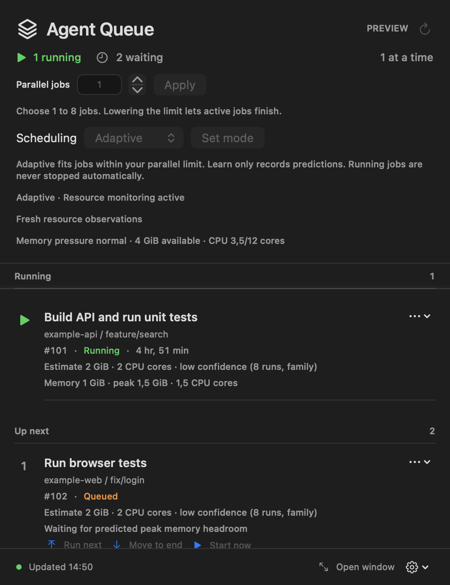
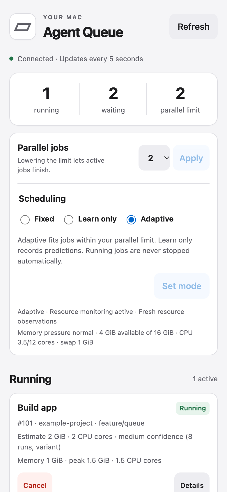
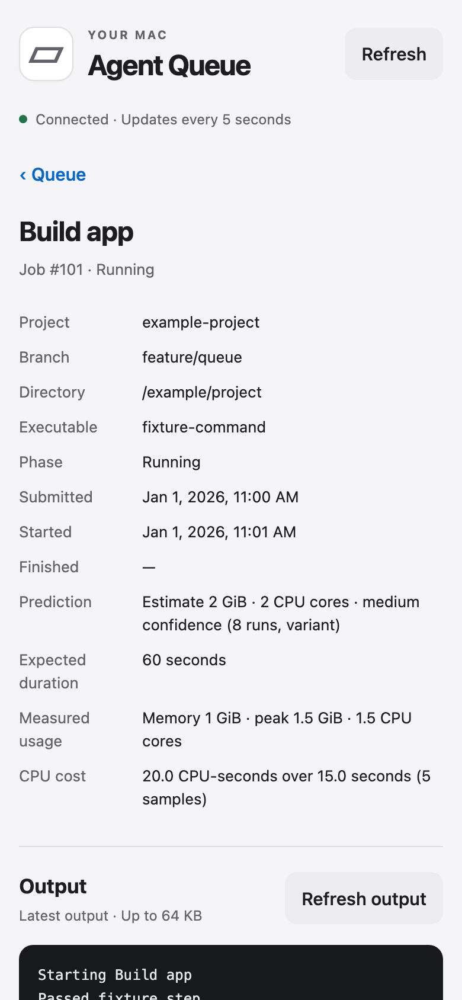

# PR 6: worktree-aware resource learning and admission

## Delivery contract

[PR 6](https://github.com/Dunky13/agent-job-queue/pull/6) implements local CPU and memory learning for recurring jobs and optional resource-based admission. The authorized endpoint is a protected merge after validation and review. Installing or activating the new controller on the operator's machine is a separate action. Existing main-branch installer publication remains controlled by the repository workflow.

## Result

Fixed remains the default. Learn only measures jobs and records hypothetical admission decisions while retaining ordinary count-based scheduling. Adaptive starts waiting jobs when fresh host telemetry and conservative learned envelopes fit beneath the operator's parallel ceiling. The ceiling remains explicitly controlled between one and eight jobs.

Workload families identify logical commands and repository-relative targets using the shared Git common directory. Linked worktrees and source revisions retain family learning. Meaningful command changes, worker settings, dependency definitions, toolchain metadata and source revisions distinguish variants. Related variants borrow conservative family evidence until their own recent successes support a smaller estimate. Separate clones are deliberately not related solely by remote URL; explicit AGENT_HEAVY_PROFILE names can relate otherwise opaque jobs.

Native and phone dashboards show CPU-seconds, observed and predicted memory, CPU core demand, duration estimates, confidence, sample count, completeness and admission explanations. Resource monitoring failures remain separate from queue connectivity. Fixed and Learn only remain available when resource telemetry is unavailable.

## Architecture and boundaries

- resource_monitor.py reads native Darwin host and process counters, verifies PID birth identities and group membership, aggregates simultaneous worker footprints and cumulative observed CPU/I/O, and rejects interrupted or discontinuous sampling intervals.
- job_profiles.py computes opaque workload identities and maintains bounded private SQLite run, envelope and decision history. Five comparable successful observations within 30 days are required to lower cold-start or family reservations. Twelve recent successes support high confidence. Failed, incomplete and stale observations cannot make a job appear inexpensive; observed high peaks still increase reservations immediately.
- resource_scheduler.py runs independently of the UI and caller. Adaptive jobs are durable stashed Pueue tasks. The controller reserves demand for active and pending work, checks pressure, swap, disk and CPU headroom, and issues expiring token/boot/generation-bound grants.
- agent_heavy.py validates automatic grants under the existing ownership lease before command execution, including freshness after blocking reads. Pending and newly acquired unsampled leases prevent accidental excess overlap. Limit and mode changes share the scheduling locks. Manual Start now remains an explicit operator override.
- Native Swift models and the validated browser schema accept optional resource fields. The authenticated dashboard API exposes a strict scheduling-mode allowlist with the existing CSRF boundary.
- The installer ships the modules and a separate resource-controller login entry while preserving the independent queue daemon. Tests and previews use isolated state or simulated jobs.

Memory admission counts current host usage once and reserves possible growth above each active job's observed footprint. A safety reserve protects the machine. Combined background and candidate CPU demand must fit even when the queue is empty. Unknown workloads run alone initially. Same-priority backfill can use available capacity, while priority and bounded-wait reservation protect older jobs.

The controller never autonomously kills or suspends active jobs, rewrites commands, changes worker flags, raises the operator cap or weakens process ownership. Missing telemetry and ownership uncertainty hold new adaptive admission.

## Validation evidence

- 59 existing core tests pass. The resource feature has 39 sampler tests, 61 scheduler tests and 29 workload/profile tests covering counters, worktrees, variants, incomplete history, private storage, reservations, races, fairness and recovery.
- All 26 real-daemon acceptance tests pass against temporary private Pueue instances. They exercise fixed scheduling, adaptive overlap, lowered ceilings, manual overrides, controller loss, queued-job migration, cancellation and crash ownership. Resource demand is simulated; these are lifecycle and admission checks rather than host load benchmarks.
- Agent-instruction integration tests, 20 API/HTTPS tests, six web schema tests, nine browser tests and headless native regressions pass. Native display expectations follow the current locale. Browser mode changes and resource details were also exercised manually at desktop and phone sizes; the phone had no horizontal overflow or console errors.
- Universal ZIP and DMG builds pass. Installer tests pass against isolated user directories, and payload validation verifies ARM and Intel executables, strict deep signatures and exclusion of private state. Homebrew tests pass. Local artifacts are ad hoc signed; Apple notarization was not added.
- Python, JavaScript, shell, workflow and public-source lint checks pass. Commit and hook checks retain cryptographic signing and matching DCO sign-offs.
- Independent Standards and Spec source reviews identified and drove repairs for partial family transfer, stale grants after blocking reads, interrupted sampling, missed execution prefixes and terminal tails, empty-queue CPU fit, and stale successful history refreshed by failed prefixes. Regression coverage accompanies each repair. Cross-provider review was unavailable and is not represented as passing review.

Local checks were executed in finite component batches, with heavy work admitted through the shared queue. The final hosted result, exact head and protected merge state are available on [PR 6](https://github.com/Dunky13/agent-job-queue/pull/6). Local results alone do not establish hosted CI or release publication.

## Operator use and limitations

The CLI accepts agent-heavy scheduling fixed, agent-heavy scheduling shadow and agent-heavy scheduling adaptive. The equivalent dashboard labels are Fixed, Learn only and Adaptive. The independently installed controller must have fresh telemetry before Adaptive can admit jobs. Choosing Fixed returns managed waiting work to ordinary Pueue scheduling and preserves an intentionally paused queue.

Polling cannot observe workers or peaks that exist entirely between samples. CPU-seconds and I/O are observed lower bounds, and complete coverage describes available sampling intervals rather than kernel-enforced lifetime accounting. These estimates are admission reservations, not hard CPU or memory quotas. Pair-specific interference models, phase forecasts, energy pricing and monetary billing are outside this version. The controller updates resource envelopes; scheduling safety parameters remain fixed within the operator's constraints.

The live operator queue, installed controller, concurrency setting, credentials and active jobs were not changed by implementation or validation. After installing a published build, use Learn only to collect representative history before explicitly choosing Adaptive. Verify actual workload behavior before treating learned estimates as capacity guarantees.

The detailed design and operating contract is available in [Markdown](../adaptive-scheduling.md) and [self-contained HTML](../adaptive-scheduling.html). This handoff's HTML includes the complete text and embedded screenshots for offline reading.
