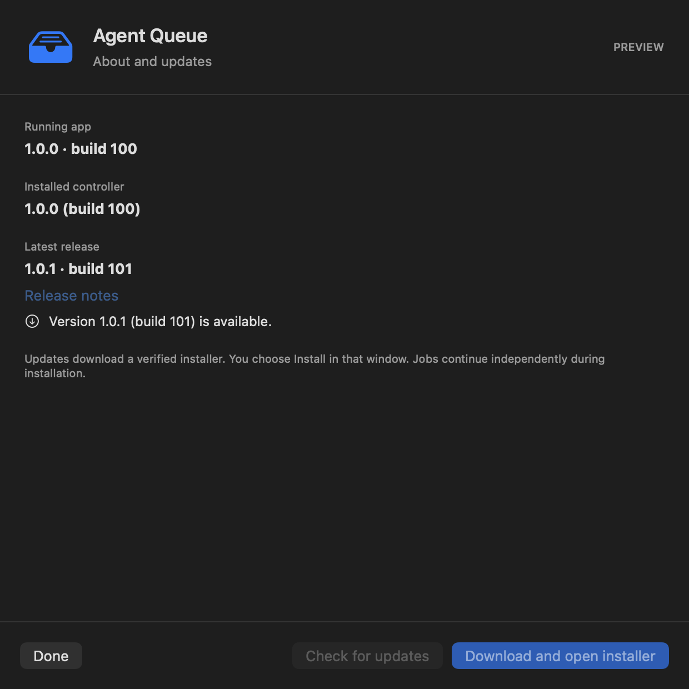

# PR 7: installed versions and verified updates

## Delivery contract

[PR 7](https://github.com/Dunky13/agent-job-queue/pull/7) adds a visible installed version, a release checker and an updater to Agent Queue. It follows the resource-scheduling work merged in PR 6. Implementation and validation preserve the independent queue daemon, active work, configuration, credentials and platform approval boundaries. The operator's installed app was inspected read-only; live installation is a separate step.

## Result and use

Choose **About and updates** in the native app's gear menu. The running bundle version appears immediately, and the installed controller identity is read locally. **Check for updates** explicitly contacts the public project release service. **Download and open installer** pins and verifies the selected build, then opens the existing installer. Choose **Install** there to complete the upgrade and restart the menu app. Opening this settings window does not make network requests.

The CLI provides agent-heavy version, agent-heavy version --json, agent-heavy updates check and agent-heavy updates check --json. Use agent-heavy updates install --build 42 with the build number actually returned by the check to prepare and open its installer. This command does not silently install.

Legacy and local builds remain visibly untracked. Their recorded bundle version is displayed without inventing a release identity. They can explicitly choose a published installer to establish release history. Known newer published running apps and installed controllers prevent downgrade. Consecutive published builds with the same semantic version are distinguished by monotonically increasing build numbers.

## Source map and boundaries

- app_updates.py owns offline installed identity, bounded public release queries, pinned availability, HTTPS host restrictions, manifest and asset digests, archive inspection, bundle identity/signature verification, private preparation and installer handoff. It refuses incomplete installations and rechecks installed identity before opening.
- release_metadata.py owns strict release and build schemas shared by runtime, packaging and the Homebrew renderer. Published main CI records version, build and full commit. Local and PR packages are untracked unless BUILD_NUMBER and SOURCE_COMMIT are explicitly supplied together for a controlled test build.
- native/AgentUpdates.swift owns the update model, running bundle identity and settings view. Operations reserve state before asynchronous work, suppress duplicate actions, report errors and never dispatch external effects from previews. Native/AgentQueue.swift exposes the gear-menu window and gives update operations their separate bounded request budget while retaining existing queue deadlines.
- Packaging embeds matching build metadata before signing. The installer checks completed, actual app and pending-install identities under its existing lock. It commits an incomplete marker before support replacement, retains that marker on failure, and clears it only after app replacement and final identity commit. Same or newer installers can recover interrupted updates.
- Automated tests use artificial releases, private installer directories and inert native commands. The screenshot is a packaged-app fixture; no real queue, credentials or private logs are included.

Checks include published prereleases and search bounded pagination. Truncated searches and failed network requests remain errors. The absolute network deadline covers stalled headers and trickling bodies, not merely idle socket time. Downloaded archives are checked against the release manifest and GitHub asset digest, then inspected for traversal, symlinks, special files and colliding paths before extraction. Both bundle versions, embedded identities and code signatures must match before opening.

The public GitHub release is the distribution trust boundary. Builds remain ad hoc signed and may require macOS approval. The updater does not remove quarantine, disable Gatekeeper or install a background updater service. Homebrew's generated cask remains compatible; direct vendor installation does not rewrite a Homebrew receipt. Older archives without embedded new-format identity remain accessible through their release pages and are not opened as verified new-format updates.

## Validation and review evidence

The initial complete local validation script passed at 649f61d: lint, 59 core tests, 100 resource tests, 29 profile tests, seven metadata tests, 19 updater tests, 29 instruction-integration tests, 26 private-daemon acceptance tests, 20 API tests, six web-schema tests, nine browser tests, native regressions, universal ZIP/DMG build and 21 installer tests. Universal architecture, signatures, build metadata and private-state exclusion were verified.

Independent Standards and Spec reviews then reproduced four issues: failed support replacement could retain a falsely completed version, an interrupted app replacement could permit a delayed downgrade, trickled network data could defeat the aggregate deadline, and a release search could silently ignore later pages. Repairs add durable incomplete state, all-identity ordering checks, an absolute CLI network deadline and bounded pagination with explicit truncation failure.

The repaired updater has 23 passing focused tests, including slow headers and bodies over local sockets and late EOF. Nine focused installer transaction and recovery cases pass; the installer suite now contains 27 tests. All 29 native update regressions pass after the final copy changes. The packaged update window was visually inspected. Heavy validation uses the shared queue; the operator installation is untouched. Final package validation, source review and exact-head hosted checks are tracked on [PR 7](https://github.com/Dunky13/agent-job-queue/pull/7), rather than inferred from an earlier head.

The detailed operating and verification contract is available in [Markdown](../updates.md) and [offline HTML](../updates.html). This handoff's HTML includes the full text and embedded screenshot for standalone reading.
