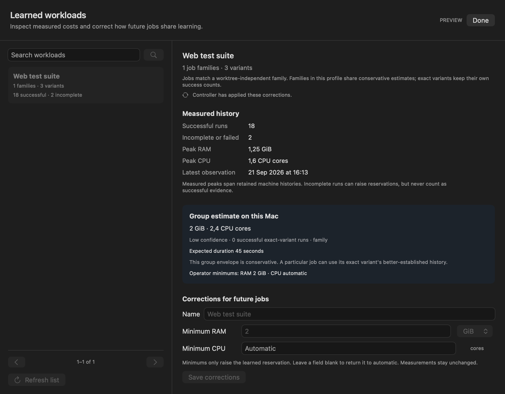
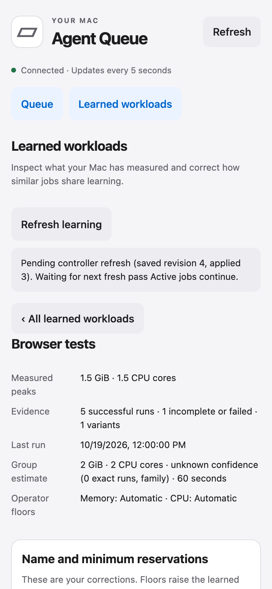

# PR 7: versions, verified updates and editable workload learning

## Delivery contract

[PR 7](https://github.com/Dunky13/agent-job-queue/pull/7) adds installed-version display, explicit release checks and verified installer handoff, together with inspection and correction of learned job costs. It builds on the independent resource controller merged in PR 6. Changes preserve Pueue ownership, active jobs, credentials and operator concurrency limits. No installation, release publication or live learning changes were performed for this work.

## Operator entry points

Choose **About and updates** in the native app's gear menu to see the running bundle and installed controller identities. **Check for updates** contacts public project releases only when requested. **Download and open installer** verifies the selected build and opens the existing installer for its final **Install** action. Legacy and local builds remain visibly untracked. Consecutive published builds can have the same semantic version and different build numbers.

Choose **Learned workloads** in the gear menu or phone navigation. Search profiles, inspect measured peaks, successful and incomplete observations, variants and recent numeric runs, then correct the name or minimum RAM/CPU reservations. **Share learning** combines similar families; **Separate family** restores independent lookup using that family's original observations. **Reset measurements** permanently removes obsolete evidence while preserving names, grouping and reservations. A job's detail view links to its current profile.

The CLI exposes the same behavior through agent-heavy version, updates and profiles. The full supported flows and request schemas are in [Updates](../updates.md) and [Learning](../learning.md). Each guide has a matching self-contained offline HTML file. This handoff is the single entry point for the combined change.

## Learning behavior and safety

Original family, variant and machine identities remain on numeric evidence. Sharing profiles changes lookup for existing and future variants; splitting restores the original family's evidence. Linked-worktree paths and source revisions remain distinct from logical family identity. Exact-variant successes are never fabricated from sibling families or variants. Group estimates describe conservative transfer to a new variant and deliberately have no exact-run success count.

Operator minimums raise reservations above automatic estimates. Renaming preserves the exact saved numbers, including odd byte counts and tiny positive CPU values. Clearing a minimum restores automatic estimation. Reset records a per-family watermark, preventing old completed-job caches from reappearing after a controller restart. An active job can contribute newly observed evidence later. Explicit corrections are pinned; bounded retention cannot silently evict them.

Every edit carries the revision the operator reviewed. SQLite applies the correction atomically. The control boundary takes the existing scheduling and ownership locks, invalidates pending automatic grants before changing learning, and captures its response before another correction can remove the saved profile. Active reservations and explicit manual grants are preserved. A controller pass that raced an edit discards its old predictions; helpers recheck the current revision before automatic admission.

An older controller and helper can retain imported code in memory. Adaptive corrections therefore require a fresh acknowledgement from a compatible controller. The installer reloads only the resource controller before clearing its durable incomplete-installation marker. Reload failure remains incomplete and retryable. The independent queue daemon continues to own active jobs throughout.

The catalog is paged and the detail view has explicit limits: 256 families, 100 variants and 30 recent runs. CLI detail uses the same limits. Counts describe retained run records; upper envelopes can outlive individual records. Numeric observations remain private. Safe existing descriptions and operator labels are retained; raw arguments, programs and environment contents are excluded. Read-only inspection creates or migrates nothing. Phone controls retain authentication and CSRF protection, strict response schemas, draft preservation and revision-bound destructive confirmations.

## Update boundary

The updater pins a published build and verifies its release manifest, asset digests, bounded archive contents, embedded identities, bundle versions and signatures before opening. Network operations have an absolute deadline across DNS, connection setup, headers and streaming bodies. Release pagination has an explicit search bound and fails honestly on truncation. Private staging is bounded and failed preparation is cleaned up.

The installer checks completed, app and pending identities under its installation lock, refuses tracked downgrades and persists incomplete state before replacing support files. The same or a newer installer can recover interrupted upgrades. Gatekeeper policy and quarantine remain under macOS control. Direct installation does not rewrite a Homebrew receipt.

## Validation and review

All automated execution uses artificial releases, profiles, jobs, temporary private daemons, isolated installer homes or inert native commands. The installed operator app was inspected read-only for version behavior; it was not upgraded. Heavy local validation uses the shared queue.

Focused evidence covers worktree grouping, future variants, independent split history, CAS conflicts, reset replay, retained peaks, admission races, surviving legacy helpers, precise floors, paging, failed requests, polling-safe drafts and confirmation invalidation. Browser regressions pass on phone and desktop widths. Forty focused native learning checks pass, including fixture semantics and opaque capture over the real window background. Native fixtures never dispatch real commands. Independent Standards and Spec reviews have no remaining findings after the repairs. Cross-provider review is unavailable and was skipped.

The complete scripts/validate.sh batch passed: lint, 59 core tests, 102 resource tests, 29 identity/profile tests, 34 new learning/control/compatibility tests, seven metadata tests, 24 updater tests, 29 agent-integration tests, 26 private-daemon tests, 23 API tests, seven schema tests, 16 browser tests, native regressions, universal ZIP/DMG packaging and 29 installer tests. A separate real private-daemon test exercised profile inspection, raising a floor to hold a waiting job, clearing it to permit overlap, and preserving the active job throughout. Focused API checks also reject oversized numeric input without a server error. After the final API and capture repairs, lint, universal packaging, 29 installer tests, actual packaged fixture capture and source-byte comparison passed again. Both app bundles contain matching build identity and verified signatures. Exact-head hosted CI and merge state must be read from [PR 7](https://github.com/Dunky13/agent-job-queue/pull/7); an earlier green head does not validate the expanded change. Release publication and operator installation remain separate from PR validation.
